# AWS Portfolio Website Architecture

```mermaid
flowchart LR
    Developer --> VSCode["VS Code"]
    VSCode --> Git
    Git --> GitHub["GitHub Repository"]
    GitHub --> Actions["GitHub Actions"]
    Actions -->|requests identity token| OIDC["GitHub OIDC"]
    OIDC -->|assumes trusted role| IAM["AWS IAM Role"]
    IAM -->|authorizes deployment| S3["Amazon S3 Bucket"]
    S3 --> CloudFront["Amazon CloudFront"]
    CloudFront --> Visitor["Website Visitor"]

    Actions -->|deploys website files using role| S3
    Actions -->|triggers cache invalidation using role| CloudFront

    classDef workflow fill:#eaf2ff,stroke:#2563eb,color:#172554
    classDef aws fill:#fff3e0,stroke:#e87900,color:#4a2600
    classDef endpoint fill:#ecfdf5,stroke:#059669,color:#064e3b
    class Developer,VSCode,Git,GitHub,Actions,OIDC workflow
    class IAM,S3,CloudFront aws
    class Visitor endpoint
```

## AWS services

- **AWS IAM Role:** Provides GitHub Actions with the permissions needed to deploy the website, using GitHub OIDC to establish trusted access.
- **Amazon S3:** Stores the website files deployed by GitHub Actions.
- **Amazon CloudFront:** Delivers the website to visitors and has its cache invalidated by GitHub Actions after deployment.
